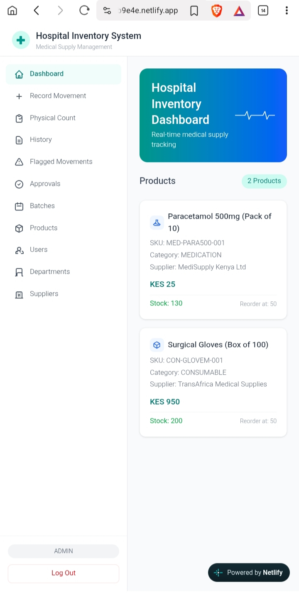
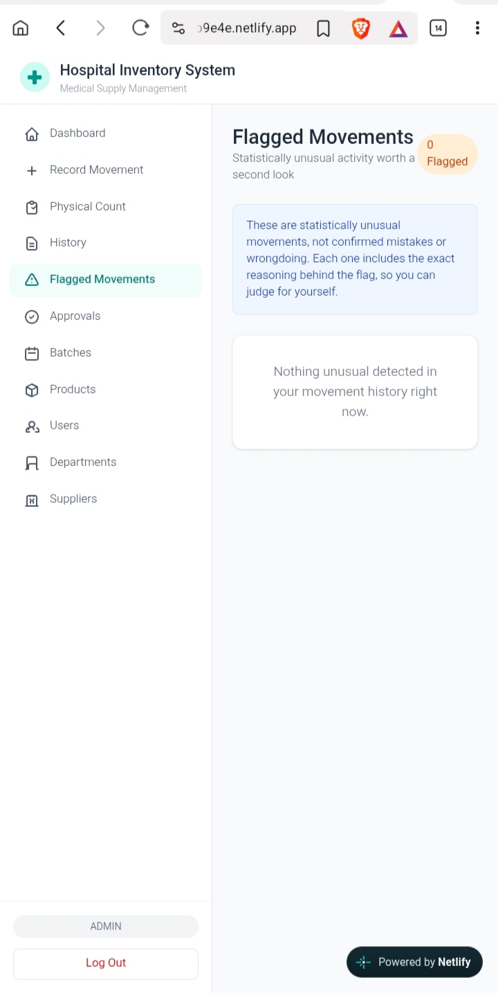
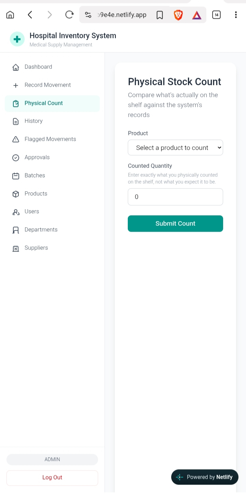

# Healthtech AI-Powered Application

A hospital medical supply inventory system built to solve a real, specific problem: **hospitals lose money and stock through untracked, unaccountable inventory movements.** Every unit of stock is traceable, every action is attributable to a real person, and the system flags unusual activity automatically — without ever pretending a black-box AI model is more trustworthy than it actually is.

**Live app:** [thriving-gumdrop-eb9e4e.netlify.app](https://thriving-gumdrop-eb9e4e.netlify.app)

**Live API:** [healthtech-ai-powered-application.onrender.com](https://healthtech-ai-powered-application.onrender.com)

**Frontend repo:** [healthtech-dashboard](https://github.com/AmasonReteti/healthtech-dashboard)

> The backend runs on a free hosting tier and goes to sleep after inactivity. The first request after idling can take 30-60 seconds to wake it up — that's expected, not a bug.

## Screenshots





*Login screen — admin-provisioned accounts only, no public self-registration.*


*Live calculated stock, color-coded against each product's reorder level.*


*Recording a stock movement, with batch and department selection where relevant.*





*Explainable, rule-based anomaly detection — every flag states exactly why.*





*Reconciling a real shelf count against the system's calculated stock.*

## The Problem This Solves

A hardware-store-style "stock in, stock out" system isn't enough for a hospital: medication expires, controlled substances need stricter tracking, and stock moves between departments, not just in and out of one building. Most inventory tools also let someone silently overwrite a stock number when a count looks wrong, erasing exactly the evidence needed to catch theft, waste, or error.

This system is built around one core design decision: **current stock is never stored directly — it is always calculated from a permanent, append-only ledger of movements.** Nobody, not even an Admin, can quietly change how much stock exists. Every change is a timestamped, attributed event.

## Key Features

- **Ledger-based stock tracking** — current stock is calculated live from every IN, DISPENSED, TRANSFER, DAMAGE, EXPIRED, and ADJUSTMENT movement ever recorded
- **Role-based access control** (JWT + Spring Security) across three real roles:
  - **Storekeeper** — records stock movements, performs physical counts
  - **Auditor** — approves or rejects pending adjustments and controlled-substance movements (two-person accountability)
  - **Admin** — manages users, suppliers, products, and departments; no public self-registration
- **Batch and expiry tracking** — stock is tracked per delivery batch, with color-coded expiry warnings
- **Department transfers** — stock moving between hospital units is tracked to a real destination
- **Physical reconciliation** — a Storekeeper's real shelf count is compared against calculated stock; a mismatch automatically creates a pending adjustment for an Auditor to review
- **Explainable anomaly detection** — statistical, rule-based flags (unusually large quantities, large single-transaction depletions), each with a plain-English reason, not a black-box score
- **Safety-first movement logic** — stock can never go negative, and controlled-substance or adjustment movements require approval before they count
- **User deactivation, not deletion** — preserves the audit trail of every movement a user ever performed
- **GraphQL endpoint** alongside REST, letting the dashboard fetch products with their calculated stock in a single request instead of many
- **Redis caching** of expensive stock calculations, with explicit cache invalidation on every stock-changing operation

## Tech Stack

**Backend:** Java, Spring Boot, Spring Security, PostgreSQL (Supabase), Redis (Upstash), GraphQL, Docker

**Frontend:** Angular, TypeScript, Tailwind CSS

**Hosting:** Render (API), Netlify (frontend)

## Architecture

```text
Browser -> Angular (Netlify) -> JWT Auth -> Spring Boot REST/GraphQL (Render, Docker)
                                                    ↓
                                      StockService (all business rules)
                                        ↓                       ↓
                      PostgreSQL (Supabase)                 Redis (Upstash)
'''

`StockService` is the single entry point for every stock change — no controller or repository is allowed to bypass it, which is what makes the negative-stock protection and approval rules impossible to accidentally skip.

## Roles at a Glance

| Action | Storekeeper | Auditor | Admin |
|---|---|---|---|
| Record stock movements | Yes | No | Yes |
| Perform physical counts | Yes | No | Yes |
| Approve/reject adjustments | No | Yes | No |
| Manage users, suppliers, departments | No | No | Yes |
| View dashboard, history, batches | Yes | Yes | Yes |

## Running Locally

**Requirements:** Java 17+, Maven, PostgreSQL, Redis

```bash
createdb hospital_inventory
./mvnw spring-boot:run
The API runs on http://localhost:8080 with sensible local defaults built in — no environment variables required for local development. See the frontend repo for the Angular client.
```

## What's Not Built Yet

Predictive reordering, auto-generated purchase orders, and barcode/QR scanning are planned but not implemented. The anomaly detection is intentionally simple and statistical, not a trained machine learning model — with the amount of data a system like this realistically has early on, an honest, explainable rule beats an impressive-sounding but unverifiable prediction.

## Why This Project

Built as a learning project to genuinely understand full-stack engineering end to end: schema design that prevents entire categories of bugs, authentication done properly, features scoped to what the data can actually support, and a real production deployment across four separate cloud services.
